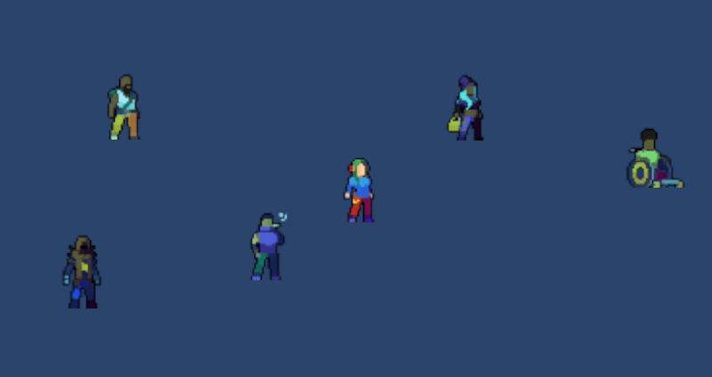

# AI Integration Task - Simple NPC Crowd

2423029
Zoe Efstathiou

#### Creation

I created a 2D top-down simulation within Unity which aimed to demonstrate personality driven NPC behaviour using custom AI. NPCs will behave differently with each other and the player based on their personality. Personalities can be easily assigned in the inspector. There is currently only three options: friendly, antisocial and crazy. Friendly NPCs approach the player when in their radius and otherwise roam. Antisocials avoid the player and move in the opposite direction. Crazy NPCs roam erratically with a more randomised direction pattern. They change direction in short intervals to remain unpredictable. This system is very simple but can be expanded more depending on the crowd system needed and personalities added. 

#### Development

I used behaviour trees to control NPC behaviour. Scripts used are BTNode and BTSelector.

> BTNode - the abstract base class for behaviour nodes. Each node returns a state: Running, Success or Failure.

> BTSelector - a selector node that evaluates its children in order. It stops when a child returns something other than Failure.

 Each NPC is given the NPCBrain script which executes the behaviour tree based on personality. 

I also added very simple sprite animations to help differentiate between NPCs. 

#### Telemetry

Within NPCBrain I've also implemented performance telemetry. It tracks the NPCs lastevaluationtime, averageevaluationtime, evaluationcount, currentbehaviour. I use C#s stopwatch class to help measure these. This can be seen in the inspector of the NPC. This helps developers monitor which state the NPC is in. Overall telemetry is useful in this case to monitor whether different behaviours have different computational costs and whether the system remains efficient as the NPC population increases.

#### AI Declaration

AI tools were used to assist with troubleshooting, understanding programming concepts, and developing the Unity implementation. AI assistance was used for guidance on C# scripting, Behaviour Tree structure, debugging and project documentation. The implementation was tested and adapted within Unity by myself.

